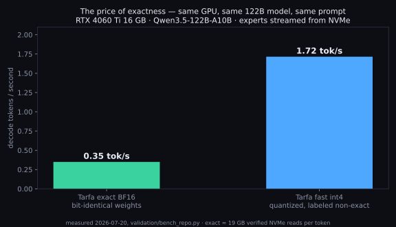
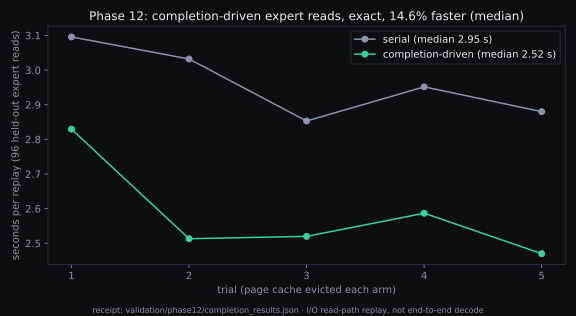
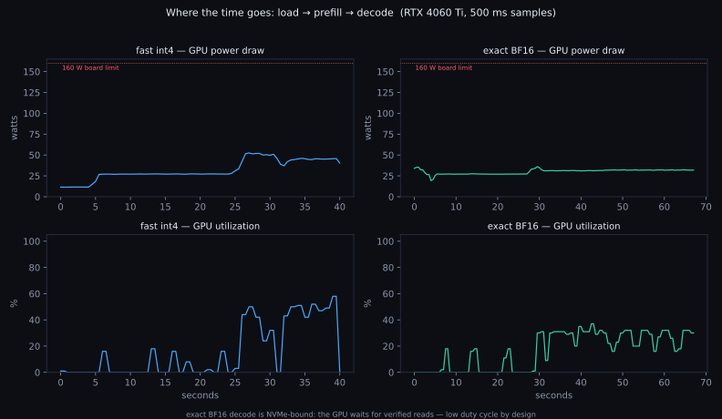
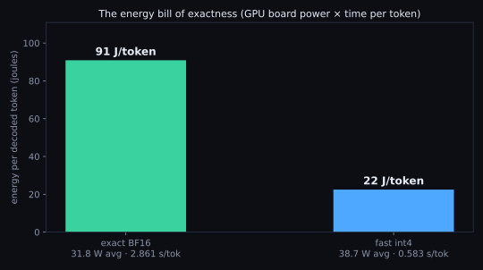

# Benchmarks: the honest version

Every number here was measured on this repo's code (`validation/bench_repo.py`), on the actual
target machine, with the JSON receipts committed in `validation/`.

**The machine:** one RTX 4060 Ti (16 GB, ~$400), PCIe 4 NVMe, 31 GB RAM. That's the whole point,
this is the hardware people actually have.

## 1. The price of exactness (same GPU, same model, same prompt)



| mode | decode | load | VRAM | weights |
|---|---|---|---|---|
| **exact BF16** (default), 2026-10-20 | **0.39 tok/s** (2.55 s/tok) | 62 s | 12.5 GB | bit-identical to checkpoint, fp32 logits |
| exact BF16, 2026-07-20 ([history](validation/history/2026-07-20/)) | 0.35 tok/s (2.87 s/tok) | 22 s | 12.4 GB | bit-identical; head ran in bf16 |
| **fast int4** (labeled), 2026-07-20 | **1.81 tok/s** (0.55 s/tok) | 21 s | 12.4 GB | int4 symmetric, per-row fp16 scale |

**Receipt setups.** 2026-07-20: both modes, one RTX 4060 Ti, 31 GB RAM, experts read from the HF
checkpoint on PCIe 4 NVMe. 2026-10-20 (exact only, after the fp32-logits fix and the September
engine commits): same RTX 4060 Ti alone (`CUDA_VISIBLE_DEVICES`), the process capped at 31 GiB of
RAM including page cache (`systemd-run -p MemoryMax=31G`), page cache evicted before the run,
experts read from the SHA-256-verified JNF tree on a Samsung 980 PRO (PCIe 4 NVMe). The fast-mode
int4 expert tree no longer exists on the box, so fast mode was not re-measured; the chart below is
the July paired run. Same 10-token prompt, greedy; the 8 exact tokens are identical in both runs.

Exactness costs ~5x in speed (fast-mode runs measured 1.4 to 1.8 tok/s depending on cache warmth; the committed receipt is the number in the table), because exact mode streams **~19 GB of BF16 expert weights (SHA-256-verified at convert time)
from NVMe per decoded token** while int4 moves an eighth of that. We think 0.39 tok/s for a
bit-identical 122B on a $400 GPU is remarkable; we also think you deserve to know it's 0.39 and
not "up to 2".

A detail worth reporting because it cuts both ways: on this benchmark prompt, the fast int4 mode's
greedy continuation **matched exact BF16 token-for-token** over the 8 tokens both receipts cover. Quantization often agrees. But our own
Phase 9 audit proved it doesn't always, batched-verification numerics diverge from single-token
decode, which is precisely why fast mode carries a permanent label instead of a footnote.

**Prefill and what is not yet measured.** The same receipts record prefill of the 10-token
benchmark prompt: 27.6 s in exact mode (2026-10-20; 16.2 s in July), 5.8 s in fast mode (that is the time to first token at this
prompt length). Not yet measured, and therefore not claimed: prefill throughput at realistic prompt
lengths, the maximum context that fits in the ~3.6 GB of VRAM left beside the ~12.5 GB resident
set, and agreement with an external reference implementation (`validation/golden_tokens.py`,
pending its first committed run).

## 2. What 0.39 tok/s actually buys you

Slow is a fact; what matters is what the slowness purchases. In exact mode, every decoded token is
produced by the checkpoint's own BF16 weights, read from disk as convert-time-verified bytes, through the model's
native top-8 router, with fp32 logits. There is no quantized cousin standing in for the model.
For model auditing, interpretability research, and reproducible evaluation (any work where the
object of study must *be* the model) that property isn't a nice-to-have; it's the prerequisite.
Elsewhere, engines get their speed by quietly not having it. Tarfa has it by default and posts the
bill: 2.55 seconds per token on a $400 GPU. When you don't need the guarantee, the labeled fast
mode gives the speed back.

## 3. Where the exact-mode speed came from (and what was rejected)



Completion-driven expert reads cut the held-out I/O replay from 2.95 to 2.52 s median (−14.6%,
`validation/phase12/completion_results.json`) with zero numeric change: the kind of win we accept.
This is a read-path replay, not an end-to-end decode receipt. The full ledger of accepted **and rejected** ideas
(a 1.8 GB cache with a 3.3% hit rate; a RAM arena that saved 24.7 GB of NVMe traffic and still
lost 9.9% end-to-end; speculative decoding demoted for greedy divergence) lives in
[EXACTNESS.md](EXACTNESS.md). Benchmarks that only show the wins are marketing.

## Reproduce

```bash
cd tarfa
python validation/bench_repo.py            # fast int4
BF16=1 python validation/bench_repo.py     # exact BF16
```

Receipts: `validation/bench_fast_int4.json`, `validation/bench_exact_bf16.json`,
`validation/phase12/*.json`.

## 4. Power and utilization: the GPU is not the engine room



Sampled at 500 ms with `nvidia-smi` during the runs above. The number that surprises people:
**GPU utilization averages ~26% in both modes, at 32–39 W on a 160 W card.** Tarfa is not
compute-bound; the GPU spends most of each token waiting for expert weights to arrive from NVMe.
The bottleneck is the storage path, which is exactly why the engineering effort went into preads,
pinned buffers, and transport overlap rather than kernels.



| mode | avg board power | GPU util | energy per token |
|---|---|---|---|
| exact BF16 | 31.8 W | 25.9% | **91.0 J** |
| fast int4 | 38.7 W | 25.7% | **21.3 J** |

Exactness costs ~4× the energy per token, not because it draws more power (it draws *less*),
but because each token takes longer. Receipts: `validation/power_metrics.json`.
